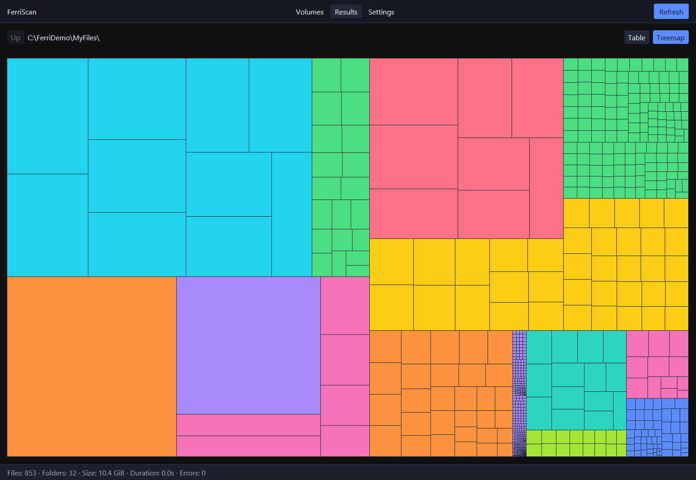
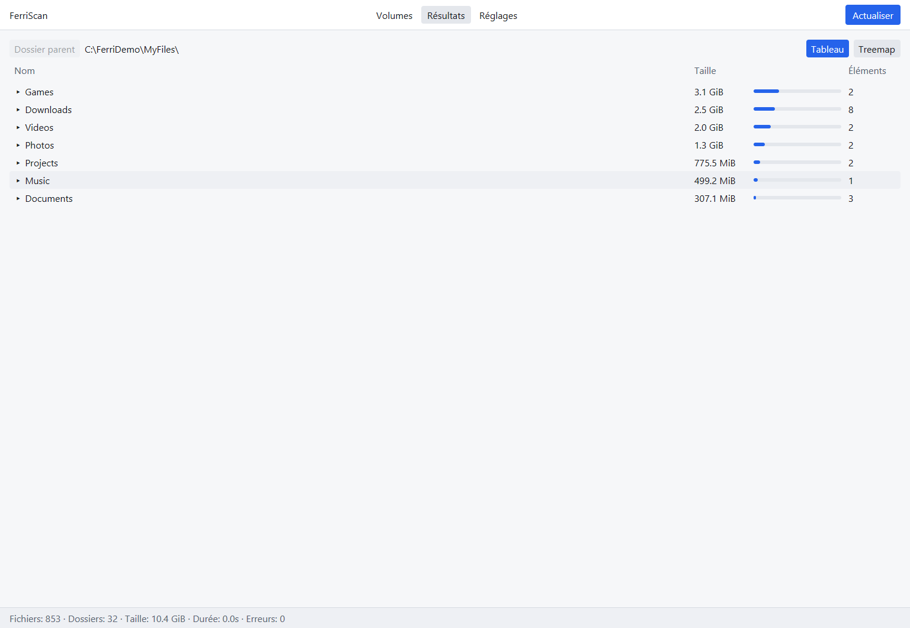
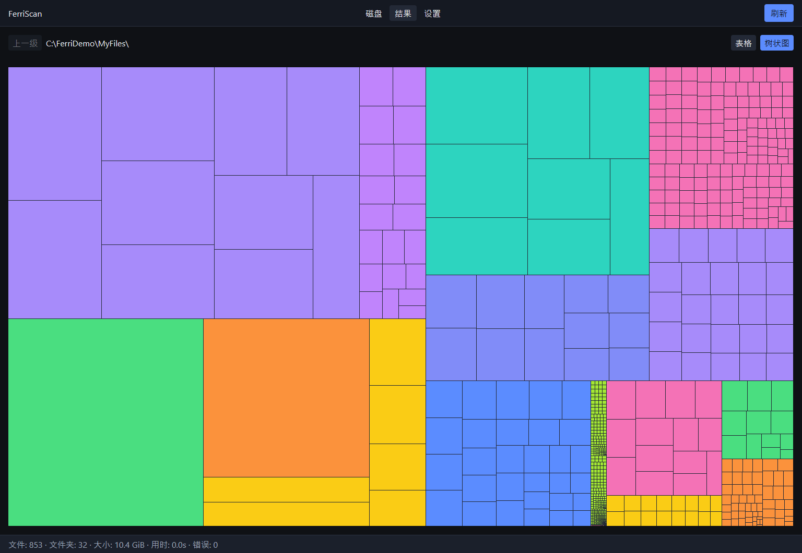
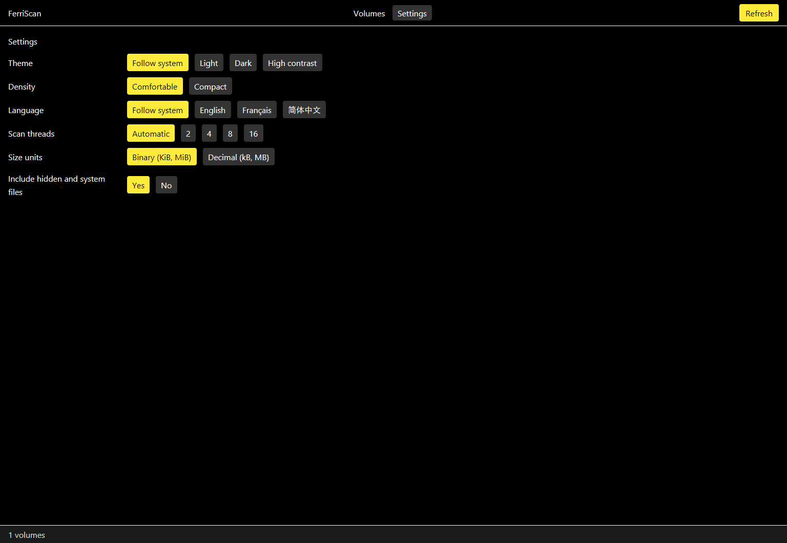
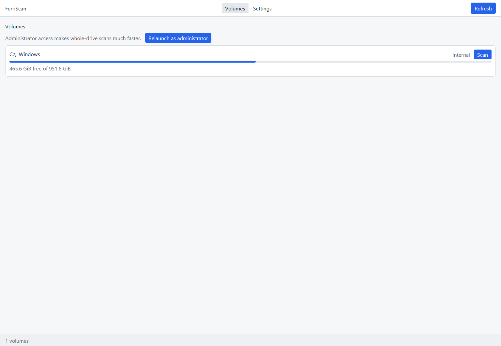

# FerriScan

A fast, private, open-source disk space analyzer, written 100 % in Rust with a native
[GPUI](https://www.gpui.rs/) interface. No webview, no Node.js, no account, no network.



FerriScan shows what is actually eating your drives: an overview of every volume, a sorted
size table you can drill into, and a treemap where every rectangle is a file or folder.

> **Status: alpha, Windows first.** Windows 10 1809+ is the supported platform today. Linux and
> macOS builds are planned but not released yet. See [`docs/ROADMAP.md`](docs/ROADMAP.md).

## Download

Installers and a portable build are attached to each
[release](https://github.com/RayanZiani/FerriScan/releases):

| File | For |
| --- | --- |
| `FerriScan-<version>-x64.msi` | Windows Installer package (managed deployments, per-machine) |
| `FerriScan-<version>-x64-setup.exe` | Guided installer (per-user, no admin needed) |
| `ferriscan-app.exe` | Portable, nothing to install |
| `SHA256SUMS.txt` | Checksums of every file |

## Features

- **Fast scans.** A bulk Windows directory reader scans a whole system drive in seconds, and an
  opt-in **MFT fast scan** (relaunch as administrator) reads the NTFS table directly:
  about 6 s for 2.8 million entries on an SSD, against 15 to 40 s for a normal walk
  ([ADR-0006](docs/adr/0006-opt-in-mft-fast-scan.md)).
- **Table view.** Folders sorted by size with an in-row size bar, item counts, breadcrumb and
  keyboard-friendly navigation.
- **Treemap.** Squarified layout colored by file type; click to select, double-click to enter a
  folder.
- **Safe actions.** Open, show in Explorer, copy path and move to the Recycle Bin. Anything that
  deletes goes through a plan you review first, and only one crate ever touches your files.
- **Three languages.** English, Français and 简体中文, picked from your system or in Settings.
- **Four themes.** Light, dark, system, and a high-contrast theme where every color pair
  reaches a 7:1 ratio.
- **Private by construction.** File contents are never read. No telemetry and no outbound
  network code, enforced in review and dependency checks
  ([ADR-0004](docs/adr/0004-no-telemetry.md)).
- **Small.** About 7 MB executable, no runtime to install.

| Table | French |
| --- | --- |
|  |  |

| Chinese treemap | Settings, high contrast |
| --- | --- |
|  |  |



The screenshots show a synthetic demo folder, not real data.

## What works today

| Area | State |
| --- | --- |
| Volume list with capacity and free space | working |
| Scan of a volume or folder, live progress, cancellation | working |
| Opt-in NTFS MFT fast scan (Windows, administrator) | working |
| Size table with drill-down and treemap | working |
| Open, show in folder, copy path, move to Recycle Bin | working |
| Settings (theme, density, language, threads, units, hidden files) | working |
| Search, extension breakdown, sunburst | engine ready, UI pending |
| Move, copy, rename, permanent delete | planning engine ready, UI pending |
| Linux and macOS | not released |

## Build from source

Prerequisites: Rust 1.98.1 (pinned by `rust-toolchain.toml`) and the Visual Studio Build Tools
(C++ workload) on Windows. See [`CONTRIBUTING.md`](CONTRIBUTING.md).

```bash
git clone https://github.com/RayanZiani/FerriScan.git
cd FerriScan
cargo run -p ferriscan-app                       # the desktop app
cargo run -p ferriscan-cli -- scan . --top 20    # headless scan
```

The app accepts a few switches for screenshots and smoke tests, none of them saved to your
settings: `ferriscan-app [PATH] [--treemap] [--settings] [--theme light|dark|contrast] [--lang en|fr|zh-CN]`.

## Verify

```bash
cargo fmt --all --check
cargo clippy --workspace --all-targets -- -D warnings
cargo test --workspace
cargo xtask i18n-check
cargo deny check
```

## Documentation

- [`docs/SPEC.md`](docs/SPEC.md): product and technical specification (the source of truth)
- [`docs/FILE_ARCHITECTURE.md`](docs/FILE_ARCHITECTURE.md): repository layout and crates
- [`docs/ROADMAP.md`](docs/ROADMAP.md): milestones and tasks
- [`docs/PRIVACY.md`](docs/PRIVACY.md): what is stored, where, and what is never collected
- [`docs/adr/`](docs/adr/): architecture decision records
- [`CHANGELOG.md`](CHANGELOG.md): what changed in each version
- [`AGENTS.md`](AGENTS.md): engineering rules for contributors

## License

MIT. See [`LICENSE`](LICENSE).
